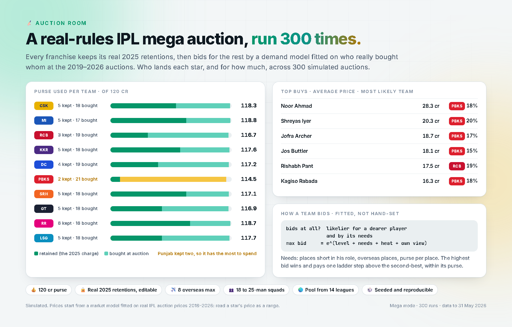
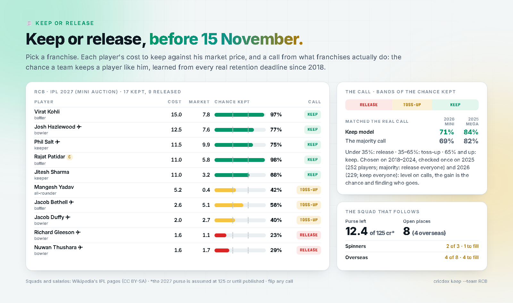
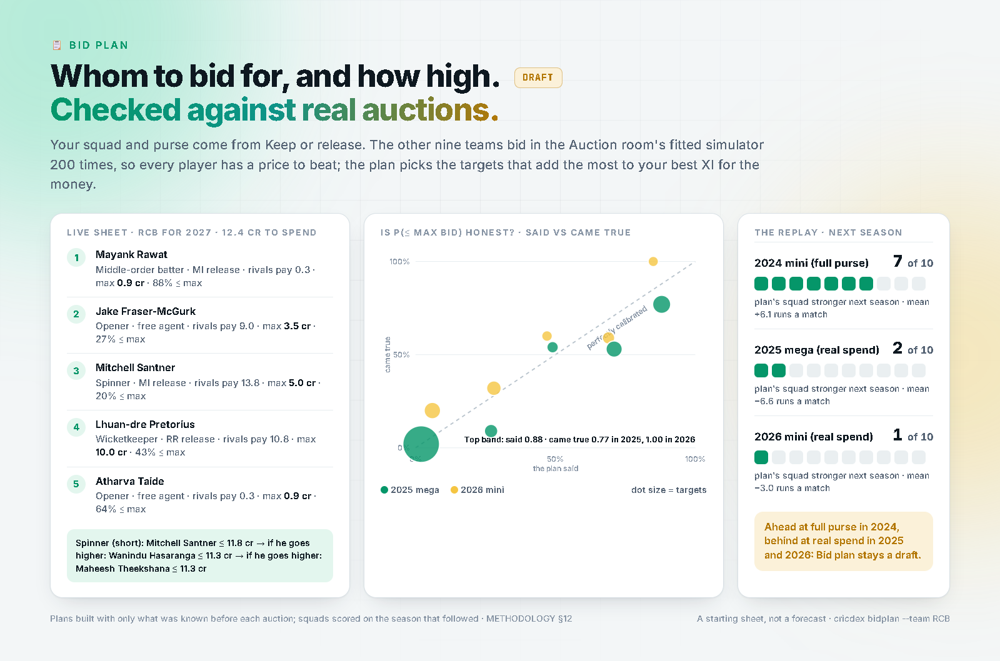
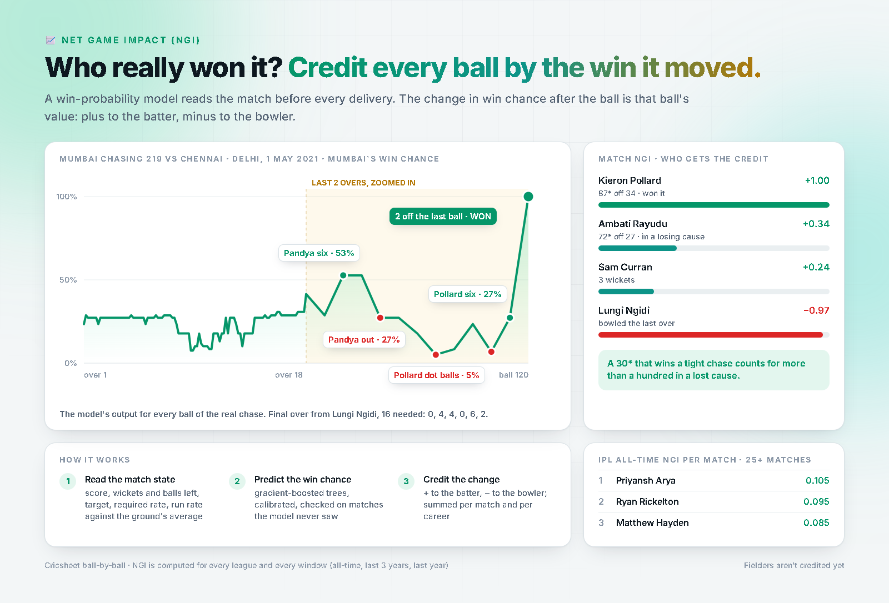
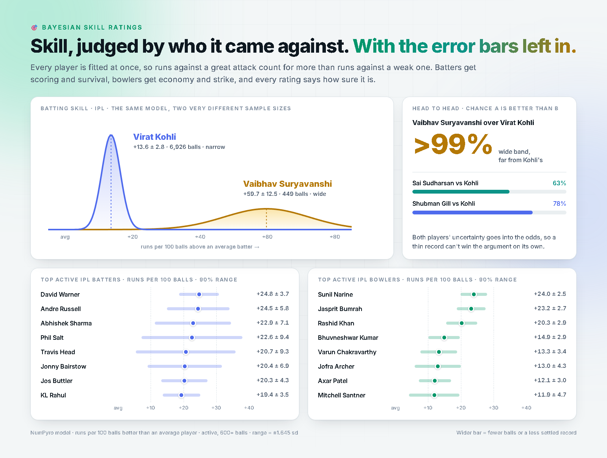
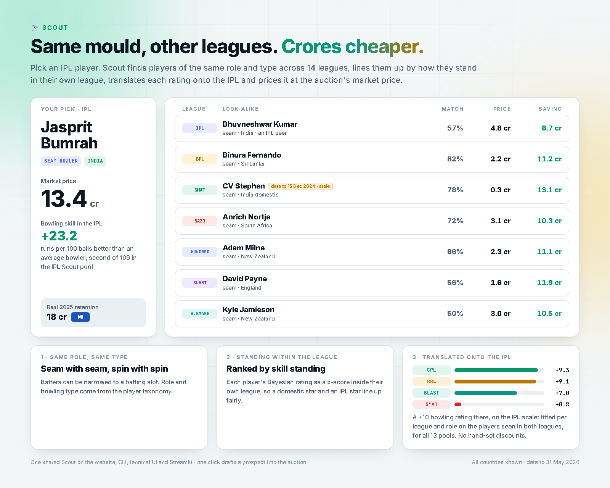
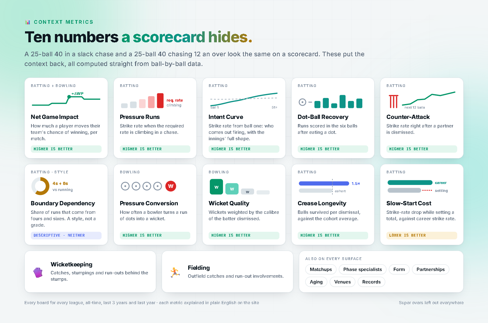
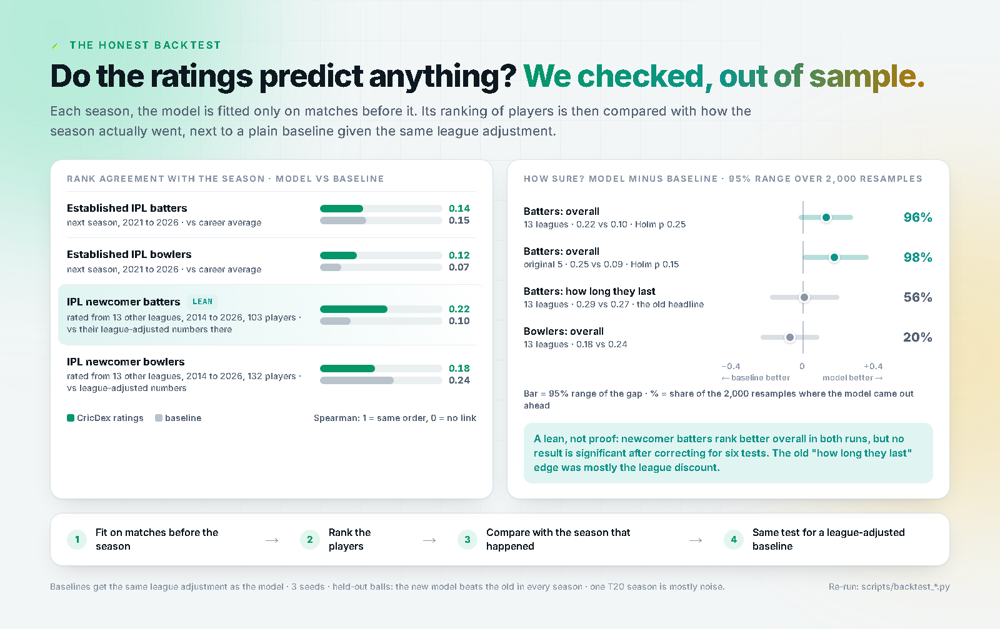
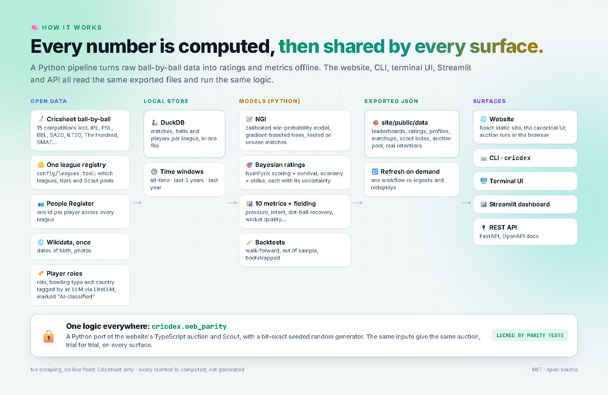

# CricDex

### The numbers behind cricket, honestly modelled.

Run the IPL mega auction yourself. See who really won a match, ball by ball. Rate every player against
the attacks they actually faced, with the error bars left in. Then check, out of sample, whether any of
it predicts anything.


[](https://github.com/Aaryan-Nakhat/cricdex/actions/workflows/ci.yml)

<p align="center"><a href="https://github.com/Aaryan-Nakhat/cricdex/raw/main/docs/media/hero.mp4"></a></p>

<p align="center"><b><a href="https://aaryan-nakhat.github.io/cricdex/">Open the live site</a></b> · no install, runs in your browser</p>

**[Auction room](#-run-the-ipl-mega-auction-yourself)** · **[Keep or release](#-keep-or-release-before-the-retention-deadline)** · **[Bid plan](#-bid-plan-for-the-auction-room-draft)** · **[Form forecast](#-form-forecast-the-next-three-seasons)** · **[Net Game Impact](#-who-really-won-it)** ·
**[Bayesian ratings](#-skill-judged-by-who-it-came-against)** · **[Scout](#-same-mould-other-leagues)** ·
**[Thirteen metrics](#-thirteen-numbers-a-scorecard-hides)** · **[The backtest](#-does-any-of-it-predict-anything)** ·
**[How it works](#-how-it-works)** · **[Quickstart](#-quickstart)** · **[Docs](#-docs)**

**10,300+ T20 matches. 2.3 million balls. Fifteen competitions. Every number computed from Cricsheet's
ball-by-ball data, and every model explained in plain English.**

---

## 🔨 Run the IPL mega auction yourself

<p align="center"></p>

Ten franchises keep their real 2025 retentions, then bid for every active T20 player. One auction is
played 300 times, so you see **who lands each star, how often, and for how much**, and how every squad
ends up.

- **Real rules:** 120 cr purse, retention slabs, 8 overseas max, 18 to 25-man squads, the IPL's bid
  ladder (5 lakh steps below 1 cr up to 25 lakh above 5 cr), as many lots as real shortlists held for the
  open places, capped sets before uncapped.
- **Bidding fitted on real auctions:** whether a team bids for a player and how high come from one demand
  model estimated on who really bought whom, and for how much, at the 2019–2026 auctions (each team's squad
  and purse rebuilt lot by lot): its places short in his role, open overseas places, purse per open place,
  how much he'd improve it, the money across the market, how far the auction has gone. No hand-set team
  personalities (estimated team effects lost out of time). Chosen on 2019–2024, then scored on 2025–26:
  about 7 in 10 real prices land inside the simulated 10–90% range (the room before: 6 in 10 and 5 in 10).
  The winner pays one ladder step above the second-best bid, and no team bids past what its purse allows;
  the retentions cost the purse what the 2025 rule charged (KKR 69 cr, not its 57 of salaries).
- **Yours to change:** release or add any retention, change the purse.
- **The pool is the whole T20 world:** IPL players plus free agents from the SMAT and every overseas
  league in the registry (BBL, SA20, CPL, T20 Blast, PSL, ILT20, The Hundred, MLC, BPL, LPL and more),
  ranked by what each is expected to add over a season: the chance he plays a match (fitted on real IPL
  XIs, tested out of time) × his runs a match above a replacement, batting and bowling at the balls he
  actually gets, so an all-rounder counts both disciplines and a league-only veteran ranks low without a
  hand-set penalty.

Prices are **fitted to real IPL auction prices** (every sale and mega retention 2018–2026, from
Wikipedia): what the market has paid for players like him, from his value on a cautious estimate, caps,
age, IPL experience and captaincy, priced at the median for his kind of player (overseas in a mega or a
mini auction, capped or uncapped Indian), with the top end priced the way the market really paid for
its dearest lots (no ceiling needed), plus the chance he's bought at all. The recipe is chosen on auctions
up to 2024. On the 2025 and 2026 auctions about half the lots land within ±50% of their price (the earlier
skill-only curve: 43%), and each auction's 20 dearest predictions fetched 0.83× them. Bidding wars for a star aren't predictable from
anything known before the auction, and the market price misses the stars of the mini auctions (their real
prices 2–8× it): the room's typical price for a star comes out low (2025: Pant's median 10.6 cr, real 27; his
10–90% range 3.2–32.3 cr; 7 of the real top 10 inside their range), so read its prices as ranges. The room models how an auction
behaves, not the exact crore of a real sale. → [How the auction works](docs/AUCTION_MATH.md)

## 🧾 Keep or release, before the retention deadline

<p align="center"></p>

IPL 2027 retention lists are due on 15 November 2026 (as reported). Pick a franchise and see what keeping each
player costs (his salary, or for a 2025 mega-auction retention the 2025 retention slabs, assumed to carry into
2027) against his market price (what players like him have fetched at real auctions), and a **Keep / Release
/ Toss-up** call from **what franchises actually do**: the chance a franchise keeps a player like him, from
a model of every real retention deadline since 2018 (price against cost, his three-season form forecast, his
ties to the side, his status, his IPL matches last season). Chosen on 2018–2024 and checked once on 2025–26:
at the 2026 deadline (a mini year, like 2027) it made the franchise's own call for 71% of players, level with
simply keeping everyone (69%) and ahead of the old price-against-salary rule (62%); its gain is the chance
itself and finding who goes (61% of 2026's releases named). The 2027 calls are written down before the deadline
([`data/predictions/`](data/predictions/)), the first clean test. Franchises hardly weigh
the cost in a mini year, so a second column, **Should they?**, asks whether he is worth what keeping him costs:
Yes when players like him fetch at least that at auction, No when even the dearer quarter of them fetch less. The reason is in one line,
then the squad that follows: purse left, open slots, and the role gaps (keepers, openers, death
bowlers, spinners, overseas) with the cheapest players in the likely pool who fill them. Flip any call, change
the purse or a role target, export the table to CSV, or share the link. Squads and salaries come from
Wikipedia's personnel pages (CC BY-SA); the cycle's rules live in
[`config/competitions.toml`](config/competitions.toml), each one sourced or marked as an assumption (the 2027
purse isn't published yet). In the terminal: `cricdex keep --team RCB`.
→ [How it decides](docs/METHODOLOGY.md#10-keep-or-release)

## 📋 Bid plan, for the auction room (draft)

<p align="center"></p>

**Draft, a starting sheet:** each max bid is what the player adds against what his money and squad place would buy later, so the bids differ player by player. In replays with only what was known beforehand, its squad beat the real one on next-season output for 7 of 10 teams at the 2024 auction (full purse), but only 2 of 10 in 2025 and 1 of 10 in 2026 at the real franchise's spend. Known gaps: a few cheap batters with a thin IPL record are overrated, and each sheet is planned as if the other nine weren't chasing the same names. Whom should your franchise bid for at the IPL 2027 auction, and how high? Bid plan takes your squad and
purse from Keep or release (your own calls carry over), lets the other nine teams bid in the Auction room's
simulator 200 times to see what each player would cost, and picks the targets that add the most to your
best XI for the money: each with a **max bid**, the odds of landing him under it, and a **fallback chain**
per role ("if he goes above 8 cr, the next spinner is worth up to 8.5"). Every assumption is editable, the
link keeps them, and the sheet exports to CSV or prints. The rivals bid by the Auction room's fitted demand
model; squad strength counts each player at his chance of playing, with the bench filling the matches the XI
misses (no hand-set depth weight or need penalty); a team never buys back its own releases (it flags
"reconsider keeping" instead). The pool is everyone not under a 2027 contract, minus announced retirements
(each with its source) and anyone without a T20 match in three years. Its "P(≤ max bid)" is checked against
what happened: about right overall (said 0.38, came true 0.39 in 2025; 0.48 / 0.52 in 2026), high in the top band
(said 0.89, came true 0.76 in 2025). A starting sheet, not a
forecast. In the terminal: `cricdex bidplan --team RCB`.
→ [How it plans, and the replay](docs/METHODOLOGY.md#12-bid-plan-draft)


## 🔮 Form forecast: the next three seasons

A retention or a mega-auction contract buys a player's next three seasons, not his career. Every active IPL
player's profile now projects his value (runs per 100 balls above average) for 2027, 2028 and 2029, **starting
from his current level**: a state-space (Kalman) model of his true level, updated by each season he plays (big
seasons count more than cameos, recent ones more than old ones), drifting with age. Then a median, an 80% range
and the chance he is still a regular, with one plain-English line ("About +5 next season (current level +11),
likely to hold that for two seasons, then decline"), and a reality check of 15 stars against their last three
seasons, each disagreement explained. The age curve is corrected for the players who were dropped
(survivorship). Backtested from 2021–23: for batters the lowest error of every baseline at every horizon; for
bowlers a tie with the career rating (which the data says is already their best current level); P(regular) beats
every baseline. Also the "3-season outlook" column in Keep or release. In the terminal: `cricdex forecast
"Kohli"` or `cricdex forecast --team RCB`.
→ [Method, survivorship and backtest](docs/METHODOLOGY.md#11-form-forecast)

## 📈 Who really won it?

<p align="center"></p>

**Net Game Impact (NGI)** credits every ball by how much it moved the win. A calibrated win-probability
model reads the match before each delivery (score, wickets and balls left, target, required rate, run
rate against the ground's average and against the league's recent scoring level). The change after the
ball is that ball's value, credited to whoever caused it: runs off the bat to the striker and against the
bowler, wides and no-balls to the bowler alone, a wicket against the batter who is out, and a share of
catches, stumpings and run outs to the fielders. So a 30* that wins a tight chase counts for more than a
hundred in a lost cause.

Every ball is scored by a model that never saw that match, and per-match numbers count the matches a
player was in the XI. → [NGI in detail](docs/METHODOLOGY.md#2-net-game-impact-ngi)

## 🎯 Skill, judged by who it came against

<p align="center"></p>

Raw averages flatter a batter who feasted on weak attacks. The Bayesian model fits every player at once,
so runs against a great attack count for more, and every ball is judged against its own season, phase,
innings and ground, so a 2026 strike rate isn't compared with a 2009 one. Batters get a **scoring** and a **survival** rating,
bowlers an **economy** and a **strike** rating, and every rating comes with **how sure it is**. The two
combine into one **value in runs per 100 balls**, with a wicket priced at what it costs where the player
bats or bowls (about 14 runs early in the powerplay, 2–3 at the death), so a finisher is judged mainly on
how fast he scores. A player
with 400 balls gets a wide range; one with 7,000 gets a narrow one. Head-to-heads ("how likely is A
better than B?") use both ranges, so a thin record can't win the argument on its own.

→ [The rating model](docs/METHODOLOGY.md#4-bayesian-skill-ratings) · [Model notes](src/cricdex/scout/ratings/README.md)

## 🔭 Same mould, other leagues

<p align="center"></p>

Pick an IPL player. **Scout** finds players of the same role and type across every pool (IPL, SMAT,
and each overseas league: BBL, SA20, CPL, T20 Blast, PSL, ILT20, The Hundred, MLC and more), ranks them by how they stand **within their own league**, and prices each
one at the auction's market price, so you see the budget swap and the saving. Uncapped prospects punching
above their sample get a gem flag, and one click drafts a prospect into the auction room.
→ [Scout](docs/SCOUT.md)

## 📊 Thirteen numbers a scorecard hides

<p align="center"></p>

A 25-ball 40 in a slack chase and a 25-ball 40 chasing 12 an over look the same on a scorecard. These
put the context back: NGI, Pressure Runs, Intent Curve, Dot-Ball Recovery, Counter-Attack, Boundary
Dependency, Wicket Quality, Crease Longevity, Slow-Start Cost, Dot-Ball Avoidance, Pace vs Spin, Finisher
Index and Left vs Right, plus wicketkeeping and fielding boards. The last four passed a reliability test
(a player's odd and even matches must rank players alike); wicket-based candidates and Pressure
Conversion failed it and aren't shown. Every board exists for every league and four time windows
(all-time, last three years, last year, and the league's era), and each metric is explained on the
site. Also on every surface: matchups, phase
specialists, form, partnerships, aging curves, records and venues. → [Metric formulas](docs/METRICS.md)

## 🧪 Does any of it predict anything?

<p align="center"></p>

We checked, out of sample. For each season the model is fitted only on matches **before** it, then its
ranking of players is compared with how the season went (Spearman rank correlation: 1 = same order,
0 = no link). The baselines get the same league adjustment as the model, every fit is run with 3 seeds,
and the newcomer gaps are bootstrapped 2,000 times with a correction for running six tests:

| | CricDex | Plain baseline |
|---|---|---|
| Established IPL batters, next season (2021–26) | **0.19** | 0.15 (career average) |
| Established IPL bowlers, next season (2021–26) | **0.15** | 0.11 (career average) |
| IPL newcomer batters, rated from other leagues (2014–26, 103 players) | **0.12** | 0.08 (league-adjusted numbers there) |
| IPL newcomer bowlers, rated from other leagues (2014–26, 132 players) | 0.25 | **0.26** (league-adjusted numbers there) |

All four are the overall rating, scored in runs per 100 balls above average.

**The honest read:** for players the IPL already knows, the ratings **beat career averages**, for batters
(0.19 vs 0.15) and bowlers (0.15 vs 0.11), and the new model predicts held-out balls better than the old one
in every season. For **newcomers rated from other leagues, they are no better than the players' own
league-adjusted numbers**: the lean for batters (0.12 vs 0.08 with every league translated onto the IPL by
the fitted league translation, ahead in 70% of resamples) is not significant, and no test survives the
correction for six comparisons. How a league's rating carries over to the IPL is fitted per league and role
and tested on 2025–26 for its level, not only its rank: a tie with the hand-set discounts it replaced
([METHODOLOGY §6d](docs/METHODOLOGY.md#6d-league-translation-a-rating-from-another-league-on-the-ipl-scale)). Earlier
versions of this page claimed a newcomer-batter edge; the first came from an unfair baseline, the second from
the old way of adding up `value`, and neither survives. A single T20 season is mostly noise. Re-run it
yourself with `scripts/backtest_ratings.py` and `scripts/backtest_newcomers.py`. The Form forecast has its own backtest (projections from 2021–23 against four baselines, `scripts/form_forecast.py backtest`): batters 21.6 / 21.4 / 20.5 runs-per-100 error one / two / three seasons ahead against 22.8 / 22.8 / 22.7 for the career rating, bowlers a tie with the rating.

**About the 2025–26 numbers on this page.** The auction, price and Keep models were each chosen on data up
to 2024 and then scored on the 2025 and 2026 seasons. Those two seasons have since been looked at many times
while building CricDex (several price recipes were scored on them, and the Bid plan replays have seen them
five times), so they are no longer a clean test: treat every 2025–26 figure as optimistic. The clean test is
the 2027 retention lists (15 Nov 2026) and auction.
→ [The backtest in detail](docs/METHODOLOGY.md#8-does-it-predict-the-backtest)

## 🧠 How it works

<p align="center"></p>

- **Open data only.** Cricsheet ball-by-ball plus its People Register (one id per player across every
  league), and a one-time Wikidata pass for dates of birth and photos. No scraping, no live feed.
- **Computed, not generated.** The one AI step tags each player's role, bowling type and country (an LLM
  via LiteLLM, any provider you set in `.env`), and it's marked "AI-classified" wherever it shows.
  Every stat and rating is computed.
- **One logic, five surfaces.** A Python pipeline builds the ratings and metrics into JSON. The static
  website reads it and runs the auction and Scout in your browser. The CLI, terminal UI, Streamlit
  dashboard and API run the same logic through `cricdex.web_parity`, a Python port with a bit-exact
  seeded random generator. Parity tests in CI keep the two identical, trial for trial.
- **Honest by default.** Super overs are left out, renamed grounds are merged into one venue, every
  rating carries its uncertainty, and the limits are written down. → [Methodology](docs/METHODOLOGY.md)

## 🚀 Quickstart

The quickest way is the [live site](https://aaryan-nakhat.github.io/cricdex/). To run it on your own
machine (Python 3.12 and [uv](https://docs.astral.sh/uv/)):

```bash
git clone https://github.com/Aaryan-Nakhat/cricdex.git
cd cricdex
uv sync                                        # CLI + terminal UI  (uv sync --extra ui adds Streamlit)

uv run cricdex init                            # set-up wizard (an LLM key is optional)
uv run cricdex data ingest cricsheet -c ipl    # IPL ball-by-ball, a few MB
uv run cricdex data ingest metrics -c ipl      # leaderboards + rebuilds the site data
uv run cricdex leaderboard ngi -c ipl --top 15 # your first query
```

Bare `cricdex` opens the terminal UI, `cricdex dashboard` the Streamlit app, `cricdex auction room`
runs the auction in your terminal and `cricdex keep --team RCB` the retention calculator. Docker: [`docs/DOCKER.md`](docs/DOCKER.md). Every command:
[`docs/CLI.md`](docs/CLI.md). Step by step: [`docs/FIRST_RUN.md`](docs/FIRST_RUN.md).

## 📚 Docs

| Read | For |
|---|---|
| [Methodology](docs/METHODOLOGY.md) | every model in plain English, with worked examples, the backtest and the limits |
| [Metrics](docs/METRICS.md) · [Auction math](docs/AUCTION_MATH.md) · [Scout](docs/SCOUT.md) · [Identity](docs/IDENTITY.md) | the exact rules behind each feature |
| [First run](docs/FIRST_RUN.md) · [Running](docs/RUNNING.md) · [Pipeline](docs/PIPELINE.md) · [CLI](docs/CLI.md) · [API](docs/API.md) · [Docker](docs/DOCKER.md) | using it |
| [Architecture](docs/ARCHITECTURE.md) · [Study guide](docs/STUDY_GUIDE.md) | how the code fits together, in depth |
| [Roadmap](docs/ROADMAP.md) · [Changelog](docs/CHANGELOG.md) · [Decisions](docs/DECISIONS.md) | where it's going and why it is the way it is |

All docs: [`docs/README.md`](docs/README.md).

## Stack

Python 3.12 and uv · DuckDB · NumPyro / JAX (Bayesian ratings) · XGBoost (win probability) · FastAPI ·
Typer + Textual (CLI, terminal UI) · Streamlit · React + Vite + Tailwind (static site on GitHub Pages) ·
Docker · GitHub Actions (tests, parity tests, on-demand data refresh and redeploy).

```
src/cricdex/     the Python package, one folder per module
scripts/         pipeline, export, backtest and README-render scripts (see scripts/README.md)
site/            the React website; site/public/data is the committed data snapshot
tests/           pytest
test_scripts/    web ↔ Python parity tests
docs/            methodology, reference and project docs; docs/media holds the README visuals
```

## Credits and license

Ball-by-ball data and the People Register come from [Cricsheet](https://cricsheet.org/), with thanks;
dates of birth and photos from [Wikidata](https://www.wikidata.org/). IPL squads, salaries and every
auction's prices 2008–2026 come from Wikipedia's IPL personnel pages (CC BY-SA 4.0; the derived
`data/curated/ipl_auction_history.json` and squads file are CC BY-SA too), and US$ auction prices are
converted at the Federal Reserve's H.10 rates (public domain). CricDex's code is MIT licensed.
